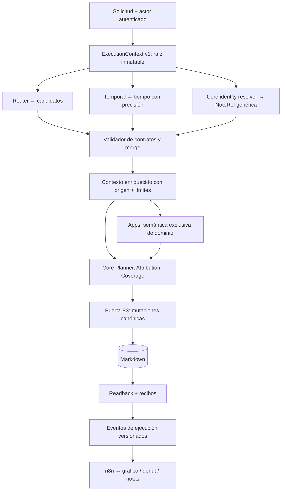

# E2 — Contrato compartido de contexto, capacidades y evidencias

**Decisión funcional aprobada por el usuario: 14-10-2026.** Este es el contrato objetivo de E2 para un sistema componible de piezas («Lego»), NO la declaración de que todas sus integraciones están desplegadas. Ver estado efectivo en [Functional Roadmap](functional-roadmap.md). Base de rama E1: PR #153 DRAFT (aún no fusionada); E2 es una rama dependiente, nunca un reemplazo de E1 ni autorización de merge/deploy.

## Objetivo

Eliminar la amplificación de cambios entre Router, Temporal, Core, Apps y el gráfico de ejecución. Cada pieza declara sus entradas, salidas, efectos, fuente y autoridad; la composición detecta dependencias ausentes **antes** de ejecutar. El contexto conserva sin pérdida el texto original, fragmentos/offsets/hashes, actor autenticado, evidencias, identidades canónicas **genéricas de cualquier tipo de nota**, dependencias, incertidumbres y recibos/telemetría. Se reutilizan los tipos ya existentes (`CoreCandidateContext`, `DomainInterpretation`, `TemporalInterpretation`, `AuthenticatedActorContext`, `CoreSpeakerEvidence`, `ApplicationResult`, `OperationalEvidence`) en vez de construir un sistema paralelo de decisiones.

## Decisiones vinculantes

1. **Identidades y referencias genéricas.** `stable_note_id` identifica cualquier nota de `config/note-schema.json` (`person`, `task`, `work_session`, `project`, `calendar_day`, tipos futuros); `note_type` solo orienta reglas diferenciales. `SELF` es una *forma particular de resolver al hablante autenticado*, no el identificador de todas las acciones ni un requisito para relacionar María con Marta. La autoría de un envío nunca implica que el remitente sea el sujeto gramatical.
2. **Un contexto tipado, inmutable y versionado en la ejecución.** El runtime es dueño del ID, fuente y actor autenticado; Router propone candidatos; Temporal propone/resuelve anclas temporales; Apps añaden exclusivamente evidencias de su dominio; Core es dueño de identidades, autorizaciones y mutaciones. Las piezas obtienen una *vista mínima* según puertos declarados. Un dato transportado no gana autoridad por haber sido transportado ni porque lleve `verified` en JSON. Los pasos del modelo no reciben credenciales ni datos irrelevantes del vault.
3. **Contratos explícitos por capacidad.** `Protocol`/`dataclass`/registro de puertos compatible por `requires`/`provides`, con validación de esquema/versión, preflight antes de efectos, y adaptadores a los carriers probados. Evitar superclases con cientos de métodos o un orquestador de microservicios adicional. En la medida posible, reemplazar las conversiones duplicadas en vez de perpetuarlas. Las etapas independientes pueden prepararse en paralelo; efectos, dependencias semánticas y writes se ordenan adecuadamente.
4. **Temporal sin pérdida semántica.** Resolver *«hoy»* a fecha, pero preservar por separado calificadores *«esta tarde», «mañana por la tarde», «ayer por la noche»* con ancla de calendario + franja textual exacta; **no** asignar 15:00 u otra hora arbitraria. Los roles temporales los propone/valida el intérprete, nunca un diccionario rígido de frases; fuente original, zona y precisión permanecen verificables. Consumidores Tasks, Events, Calendar, Notes y Work Sessions acceden a la misma representación sin reparseo autónomo.
5. **Interfaz y gráfico como consumidores genéricos.** Cada etapa emite eventos observados con `request_id`, `stage_id`, padre, orden, estado, duración/coste disponibles y resumen acotado sin trazas privadas; runtime → n8n → web deben validar la misma versión. La UI proyecta etapas reales; el donut no inventa progreso ni pierde entradas cuando se agrega una capacidad; estados parciales y recibos sobreviven al transporte. El contrato de telemetría jamás confiere autoridad de escritura.
6. **Un único camino final de mutación es E3.** Chat puede pasar por Router/Temporal/Planner; checkbox/edición por UI pueden omitir interpretación; un editor de Work Session/Fact puede invocar optativamente el servicio *común* de resolución de notas y links. Todas confluyen en E3, que centraliza autorización, targets, revisiones/concurrencia, referencias, idempotencia, materialización/historial y readback, reutilizando `materialization.py`/`persistence.py`/Writer existentes, no otro Writer. Work Sessions son Notes con lifecycle diferencial y texto capaz de enlazar con cualquier otro tipo de nota. **No** desarrollar ahora todos los botones ni rediseñar la UI.
7. **Seguridad.** Core valida siempre el texto/offsets/hashes, vinculación de actor y autoridad específica del emisor, frescura, completitud y destino antes de la mutación. Atributos externos autoafirmados, similitudes de nombres o sugerencias de Router no son garantías. Conservar fail-closed y aislamiento local-first. No tocar PROD ni vault real para pruebas.

## Arquitectura de puertos



La flecha Core Identity se refiere a un *servicio compartido*, no a un tercer modelo obligatorio. La preparación puede ser concurrente solo cuando no existe relación de datos entre etapas. Los gráficos describen el destino, no aseguran que todos los adaptadores ya estén desplegados.

## Ejemplos contractuales

- «Ayer María vio a Marta»: actor autenticado distinto de sujeto; dos referencias `NoteRef` tipo `person`, **ningún** `SELF`.
- «Hablé con Eric»: `SPEAKER` propuesto por fuente; el validador Core decide si puede usar `SELF` como referencia a una Note person existente.
- «Hoy preparé el informe para Proyecto Atlas»: relaciones genéricas a `project` y posibles `task`, sin validadores nuevos por cada NoteSchema.
- «Mañana por la tarde»: `{source:"mañana por la tarde", date:"2026-10-15", daypart:"por la tarde", exact_time:null, timezone:"Europe/Paris"}` con fecha de referencia 14-10-2026.
- UI Work Session: editor → (resolución opcional de entidades) → E3; no necesitar Router/Planner para una edición de estructura ya identificada.

## Definición de terminado de E2

- Un port y un contexto compartido funcionan en un flujo productivo con adapters para Router, Temporal, Core y Apps, sin autoridad implícita ni caminos de contexto competidores.
- Generic NoteRef y ambigüedad probados con al menos person, task, project, work_session y calendario más un tipo desconocido definido en esquema; no existe `person_id` como infraestructura general.
- Qualifiers temporales conservan precisión original en handoff de Temporal al consumidor y (cuando el producto pide texto) a la salida Markdown/UI; tests de día sin cualificador, fecha con franja, exact time y ambigüedades.
- Una App ficticia consume el contrato sin cambiar el dispatcher central ni crear su propia lógica de fechas/enlaces/escritura.
- Pruebas negativas: actor falso, offsets/hashes alterados, evidencia sin resolver, contexto cruzado, proveedor adversarial, entregas parcialmente escritas y replay.
- Un evento nuevo de backend sobrevive al contrato runtime→n8n→web sin cambiar listas rígidas en cada capa; respeta costes/latencias y no revela contenido sensible.
- Tests unitarios + verticales y gate del despliegue independiente; nunca confundir pruebas sintéticas con aceptación de modelo real. Sin nuevos servicios, graph DB ni reescritura general.

## Architecture challenge (inicio E2)

**PROCEED**, con alcance incremental: `DomainInterpretation`, `CoreCandidateContext`, contratos de actor y telemetría ya resuelven partes importantes. Un contrato común de *transporte y comprobación* encima de esos modelos es más sencillo que reescribir Core o sustituir todo por un framework/ABC común. Riesgo prioritario: que un `Context` universal duplique fuentes de verdad o filtre privilegios a Router. Mitigación: estructura inmutable limitada, validación estricta, proyección de mínimos por etapa, persistencia/identidad solo mediante Core; primer slice provider-free en rama dependiente E1. No se requieren cambios de proveedor, despliegue, esquema canónico ni servicios.

## Primer incremento implementado (15-10-2026, provider-free, NO desplegado)

- `odyssey_core/execution_context.py`: `ExecutionContext(version=1)` inmutable, fuente/fecha/actor autenticado inmutables; reutilización validada de `CoreCandidateContext` y `DomainInterpretation`, sin duplicar sus semánticas. `NoteReferenceCandidate`/`NoteMention` representan **hipótesis** genéricas de cualquier `NoteSchema`, no resuelven identidades ni autorizan mutaciones. `QualitativeTime` conserva un cualificador literal verificado contra un `temporal_reference` exacto existente; no añade 15:00 ni analiza lenguaje con diccionarios.
- Puertos explícitos `ContextPort`/`StageSpec`/`StageInput`/`StageOutput`/`ContextStage(Protocol)` y `run_context_stage` validan datos disponibles, origen y outputs declarados. `stage_input` oculta actor, reloj y evidencias fuera de los puertos solicitados. `run_independent_stages` usa threads solamente para propuestas sin dependencia entre outputs; valida dependencia *antes* de ejecutar y fusiona el resultado a una nueva copia inmutable. No paraleliza escrituras.
- `odyssey_runtime/candidate_route_dispatch.py`: justo antes del Planner/Writer de Core, valida un `ExecutionContext` formado por el `CoreCandidateContext` revisado, las evidencias `DomainInterpretation` y el actor confiable; entrega a Core el carrier revalidado, sin sustituir sus guards ni cambiar las acciones propuestas. Es una primera conexión real del nuevo contrato, **todavía no una migración completa de todos los traspasos**, y no ejecuta `StageSpec` del Router/Temporal de producción en este slice.
- `tests/core/test_execution_context.py`: contrato simulado completo Temporal + resolvedor genérico de tipos de nota + App ficticia, equivalencia de orden de dos contribuciones, ejecución realmente simultánea mediante barrier, dependencia negativa, inmutabilidad, fuente falsa, actor falsificado, capacidad duplicada, fechas/cualificadores incongruentes, referencia ambigua y `no-write` implícito. Los tests de dispatcher real, Tasks, Writer y Temporal cubren el seam sin cambios semánticos.

**Gate primer incremento:** full pytest **3184 passed, 80 skipped, los mismos 10 fallos históricos preexistentes** (52 subtests), Node **150 passed**, Ruff lint/format, esquema canónico y diff correctos. Estos tests no prueban que el LLM genere dayparts ni que la UI los renderice.

**No está hecho:** producción de `QualitativeTime` por el modelo real; links automáticos de editor/UI, serialización uniforme de eventos Python→n8n→web, todas las Apps como consumidores nativos del contexto, repositorio de identidad canónica, pruebas live/deploy y E3. Estas entregas siguen en los gates de arriba; ningún port por sí solo vuelve infalible la interpretación gramatical.

## Segundo incremento — búsquedas independientes y precisión temporal (15-10-2026, provider-free)

**Objetivo comprobado:** las menciones independientes a María, Marta, un proyecto, documento o cualquier tipo *referenceable* pueden consultarse en paralelo entre sí y con Temporal, sin sacrificar la fuente, fabricar identidades o escribir en el Vault. No hay obligación de insertar búsquedas adicionales de modelos tras cada frase: el despachador de las búsquedas trabaja con menciones **ya extraídas** y offsets originales. La extracción de menciones, selección semántica/contextual, anáforas y sujetos colectivos siguen sujetos a Core y las evidencias source-bound.

- `odyssey_core/note_lookup_batch.py`: nuevo **adaptador fino** `ParallelExactNoteLookup`, que delega cada mención en `resolve_exact_entity` existente de Core, sin rehacer normalización de nombres, alias o lectura canónica. `NoteLookupRequest(text,start,end,note_type?)` conserva los offsets; máximo **12 menciones / 3 workers** por lote, preserva orden lógico aunque las búsquedas acaben desordenadas, prohíbe spans duplicados/forjados, devuelve `NoteMention` con candidatos tipados y `PendingContext` anclado a la mención para ausencias, ambigüedad y tipos no compatibles; más de 8 homónimos queda pendiente íntegramente, NUNCA truncar arbitrariamente. Error de un worker falla todo el lote antes de merge, sin partial knowledge ni mutaciones; cada request Core revalida en escritura la identidad y estado del repositorio.
- **Corrección del inventario tras comprobar el esquema COMPLETO del runtime:** el fichero base `config/note-schema.json` declara `{concept, project, document, person, journal_entry}` como referencia ordinaria. Pero `odyssey_runtime/composition.py` compone también `TASK_SCHEMA_EXTENSION` y **`task` SÍ está declarado como `referenceable=True` en el esquema de producción**, de modo que el mismo `resolve_exact_entity` Core lo resuelve. `work_session` se declara `referenceable=False`, `notes_visible=False`, `content_writable=False` y tiene lifecycle propio de Tasks; `calendar_day` se gestiona por fecha determinista en Core y tampoco es una referencia ordinaria. No tratar estas últimas entidades como `person` ni convertir permisos de lectura en facultades de link/mutación. En fixture con esquema compuesto, el lote concurrente real resuelve Marta, Task y Proyecto Atlas con una única implementación genérica.
- `odyssey_core/execution_context.py`: `NoteMention` y `PendingContext` llevan offsets exactos opcionales y permanecen validados al fusionar en el contexto; una fecha exacta común satisface el puerto `TEMPORAL` aunque no tenga franja («hoy» no puede romperse al introducir «por la tarde»). Los puertos son proyecciones de datos, nunca permisos de lectura general/Writer.
- `odyssey_core/temporal_qualifier_handoff.py` + `odyssey_runtime/candidate_route_dispatch.py`: cuando **la misma** mención de `TemporalInterpretation` tiene resolución `EXACT_DATE` y una única cita `time_approx` de `CoreCandidateContext` se encuentra dentro de su span original, el runtime conserva también `QualitativeTime(date, qualifier, timezone)`, solo si coincide con un `DomainInterpretation` temporal exacto. No se inventan horas; nada que no esté doblemente anclado se eleva a evidencia. Se usa la zona horaria del Temporal si existe, si no la configuración. La estructura está enlazada al handoff hacia Core, pero **no se ha completado** el consumo de esas franjas por Planner, Writer, Markdown o UI. «Esta tarde» sin resolución de fecha exacta y casos `UNSPECIFIED` siguen requiriendo el trabajo E2 del intérprete, sin aceptar inferencias arbitrarias.
- `tests/core/test_parallel_note_lookup.py`, `test_temporal_qualifier_handoff.py`, `test_execution_context.py`: semántica real de `resolve_exact_entity` con dos Martas homónimas y dos menciones, María y proyecto; búsqueda exacta sin coincidencias, tipo gestionado, búsqueda en paralelo con barrera, simultaneidad entre batch y Temporal, overflows, errores parciales, fakes de fuente, plus temporal multilingüe ES/FR/EN, exact time incompatible y fecha sin cualificador. Las pruebas funcionales de `candidate_route_dispatch`/Writer guardan las rutas existentes.

**Rendimiento:** la paralelización propuesta es acotada porque cada `resolve_exact_entity` ordinario lee notas; en vaults grandes un fan-out aumenta lecturas simultáneas. Comparar latencia, CPU, E/S y memoria en fixtures representativos antes de habilitarla para todas las solicitudes DEV. Un snapshot compartido/batch indexable puede resultar más eficiente después, pero no se debe duplicar un resolvedor canónico ni relajar sus validaciones para obtener velocidad. El lote actual no participa todavía en los caminos automáticos del chat: es un adaptador verificable llamado por el sistema de puertos y listo para registrar menciones extraídas cuando esa frontera se estabilice.

**Gate verificado del segundo incremento:** suite completa Python **3202 passed, 80 skipped, los mismos 10 fallos históricos existentes** (52 subtests), Node **150 passed**, Ruff check/format, schema y diff PASS. El aumento de tests corresponde a los contratos genéricos, batch real de Core y los time qualifiers. PR apilada #154 continúa DRAFT; E2 sigue abierta.

## Tercer incremento — unificación de puertos de tipos gestionados (15-10-2026, DRAFT)

- `odyssey_core/managed_note_identity.py` introduce un **`ManagedNoteIdentityPort(Protocol)`** de solo lectura, implementado por composición y **sin herencia** en `CalendarDayIdentityPort` (delegación en `CalendarDayRepository.resolve`) y `WorkSessionIdentityPort` (delegación en `TaskWorkSessionService.list_for_task` bajo propietario Task explícito). Un `ManagedNoteHandle(stable_note_id, note_type, owner, materialized)` es **evidencia de localización, no un `NoteReferenceCandidate` autorizable**. `locate_managed_note` valida el propietario real declarado por el esquema compuesto y el tipo de resultado. La búsqueda de Work Session exige ID exacto y Task padre; no convierte menciones ambiguas a sesión en enlaces. Un Calendar Day virtual no se materializa por consultarlo.
- `ManagedNoteContextStage` implementa el mismo `ContextStage(Protocol)` y utiliza `StageSpec` para adjuntar esos handles al `ExecutionContext` bajo el puerto `MANAGED_NOTES` de forma inmutable. Cualquier App puede consumirlos mediante `stage_input`, sin permitir acceso al actor ni a la fuente si no los declara. Sigue siendo un adaptador de lectura y NO sustituye el Writer ni la autorización de mutación de E3.
- `tests/core/test_managed_note_identity.py` demuestra el contrato sobre fixtures de Notes reales: Task se identifica con el **Core exacto existente y esquema extendido**, días virtuales/materializados mediante el dueño Core, Work Sessions existentes y restringidas por Task propietario, propietario falso/método mal tipado rechazado en el resultado de ejecución y dos tipos de nota gestionados agregados al contexto común. Un ejemplo de texto de actividad de Work Session con «Proyecto Atlas» pasa por `ParallelExactNoteLookup` y prepara la referencia genérica `project` sin escribir enlaces todavía.
- **Cómo se impone `Protocol`:** Python acepta *structural typing* sin heredar de la clase `Protocol`; el tipador estático debe verificar firmas y retornos, mientras que `@runtime_checkable`/`isinstance` **solo inspeccionan presencia de atributos**, no tipos de parámetros o resultados. Por eso E2 valida explícitamente `StageSpec`, `StageInput`, `StageOutput`, propietario, esquema y `ManagedNoteHandle` después de la llamada. En el entorno Pi actual no hay mypy/pyright instalado; la prueba de forma en tiempo de ejecución NO sustituye una comprobación estática futura. Los ejemplos explicativos de esta diferencia pertenecen a la documentación del contrato.

**Gate completo tras el tercer incremento:** **3214 Python passed, 80 skipped, los mismos 10 fallos históricos** (52 subtests), **150 Node passed**, Ruff lint/format, validación de esquema y diff PASS. Los fallos históricos de benchmarks/prompt configs y pricing aún hacen que el comando global de pytest termine con exit 1: sin regressiones nuevas, pero no se debe etiquetar el gate global como verde. No se han ejecutado pruebas con proveedor ni despliegue del código de E2.

**Pendiente:** producción automática de `NoteLookupRequest` con offsets desde la fuente, adaptadores completos del editor Work Session y UI, conversión verificada de referencias en Markdown mediante el gate E3, cobertura de concurrencia/latencia en grandes vaults y eventos versionados hasta el gráfico. No se ha cambiado el `TASK_SCHEMA_EXTENSION` ni la autoridad de Work Sessions.

## Cuarto incremento — fuente → lookup → Planner compatible; un solo recorrido del Vault (15-10-2026)

**Problema detectado mediante medición en la Raspberry Pi:** la prueba descartable con 260 Note `person` válidas y 3 menciones independientes arrojó **~113 ms** secuencial frente a **~147 ms** con tres lectores concurrentes: cada llamada a `resolve_exact_entity` volvía a leer y validar las mismas 260 notas. El fan-out por hilo no puede asumirse más rápido que un trabajo I/O repetido.

**Corrección general, sin tercer resolvedor:** `odyssey_core/identity.py` ofrece `find_exact_entity_candidates_batch` y `resolve_exact_entities_batch`: **exactamente la lógica de identidad existente** (Unicode NFC, casefold, espacios, nombre vs alias, tipo del NoteSchema, deleted, homónimos y orden) ahora recorriendo cada nota **una sola vez** para las 1–12 consultas; el método anterior `find_exact_entity_candidates` delega a ese mismo batch con una sola consulta. Un error de nota canónica invalida el lote completo, no entrega éxitos parciales. El adaptador `ParallelExactNoteLookup` utiliza este batch como camino real predeterminado (puede ejecutar una búsqueda única en paralelo con Temporal); la estrategia por hilos queda para implementaciones inyectadas con trabajos que sí sean independientes. La medición con el mismo fixture cayó a **~38 ms** por lote, ~3× más rápido que tres resoluciones secuenciales. Es una medición local sintética, no una promesa de latencia DEV o producción. No se ha modificado el esquema canónico ni las reglas de autorización.

**Fuente común de menciones (evita parches por frases):** `canonical_source_context.source_note_role_spans` y `note_lookup_batch.note_lookup_requests_from_source_roles` comparten las roles genéricas **subject / participants / object / reference** validadas por `CoreCandidateContext`. Su extracción lleva posición Python exacta, conserva usos repetidos de una misma nota, deduplica el mismo span citado dos veces y no adivina nombres, separa por `y`, ni supone que todo es `person`. El helper antiguo `matching_canonical_source_names` vuelve a usar esa misma extracción, conservando sus comprobaciones de hints sin otorgar autoridad al Router. Más de 12 spans requiere tratamiento explícito: no se truncan ni se inventan identidades.

**Primera ruta real compatible, sin modificar la existente:** `odyssey_runtime/context_planner_ports.py` introduce `ContextAwareCorePlannerFactory(Protocol)` con método `create_for_context(ctx: ExecutionContext)`. En el dispatcher híbrido, cuando el factory implementa *estructuralmente* este puerto, se ejecuta la preparación tipada E2 desde los roles actuales: `ExecutionContext` → `NoteLookupRequest` → `ParallelExactNoteLookup` → `ExecutionContext.note_mentions/pending` → `create_for_context(ctx)` → **Planner de Core original** → Core coverage/preflight → Writer/readback originales. Los factories existentes con forma `factory(candidate_context, domain)` siguen ejecutándose **sin lecturas añadidas, mismo contrato, mismo Writer**. Esta puerta es de lectura: los NoteReferenceCandidates son hipótesis, no identidad validada para escribir. No se altera el prompt ni el modelo de producción.

```python
@runtime_checkable
class ContextAwareCorePlannerFactory(Protocol):
    def create_for_context(self, context: ExecutionContext) -> object: ...

# Compatible SIN heredar el Protocol:
class MiPlannerFactory:
    def create_for_context(self, ctx):
        # ctx.note_mentions = candidatos fuente+offsets, sin autoridad de write
        return planner_core_existente

# Dispatcher: crea contexto, ejecuta etapa de lookup, y usa el nuevo puerto
# solo si el factory está conectado. La rama antigua continúa intacta.
```

**Evidencia de integración:** `tests/runtime/test_e2_context_planner_integration.py` ejecuta un route v2 real `«Hoy hablé con Bea.»` con fuente exacta, rol participants, Temporal, Core candidato/cobertura, **Core Writer y Markdown readback**, comparando el puerto nuevo y el factory de dos argumentos antiguo. Los tests de `identity.py` cubren alias, Unicode, homónimos intertipo, ausencia, una sola enumeración de vault y fallo de un Note inválido; los tests del adaptador prueban reaparición de Marta en dos offsets de la misma frase y protección de presupuesto. No hay escrituras fuera de fixtures.

**Gate de regresión tras el cuarto incremento:** pytest completo **3222 correctos, 80 omitidos, los mismos 10 fallos históricos** (52 subtests), por tanto comando global exit 1, no «todo verde». **150 Node correctos**, Ruff lint/format, esquema y diff PASS; **46 pruebas específicas** de contexto fuente, batch, identidad, alias y Writer, más el resto de la suite. No se ejecutaron proveedores ni deploy ni mutación del vault personal.

**Limitación explícita:** en producción, el constructor real del Planner aún utiliza el factory antiguo y el `matching_canonical_source_names` de lectura única; el nuevo contrato se activa solo con una implementación `ContextAwareCorePlannerFactory` inyectada. Temporal sigue procesándose antes del lookup en el dispatcher actual; su paralelización con la lectura en una ejecución real requiere reubicar la preparación en el motor que ya conoce los grupos, preservando dependencias y la decisión de no duplicar lecturas. E2 no está cerrada ni desplegada.

## Quinto incremento — composición híbrida real + ejecución simultánea + hint único (15-10-2026)

- **Conexión a la composición efectiva:** `odyssey_runtime/composition.py` ahora crea `OpenAILunaContextPlannerFactory` para el **hybrid DEV opt-in** en lugar de la antigua lambda `(candidate_context, domain)`. El adaptador implementa estructuralmente `ContextAwareCorePlannerFactory(Protocol)` y crea el **mismo** `OpenAILunaExperimentalPlanner` con mismo cliente, esquema compuesto, reloj, modelo GPT-5.6, esfuerzo y prompts predeterminados. Los Planners antiguos de dos argumentos siguen siendo compatibles en el dispatcher (ninguna migración global, sin cambio de proveedor ni nueva autoridad de escritura). **No significa que se haya activado hybrid ni desplegado E2 en DEV.**
- **Paralelismo real y seguro:** dentro de **cada ruta scoped ya validada** (después de comprobación de procedencia e herencias temporales, no sobre rutas futuras), `candidate_route_dispatch.run_unit` lanza **una** búsqueda Core exacta en un worker y ejecuta la llamada de Temporal en el hilo del dispatcher. `ThreadPoolExecutor` se cierra antes de continuar al Planner y el resultado se fusiona en un solo `ExecutionContext` fuente/actor/temporal/note_mentions/pending; error de cualquier paso impide llegar al Writer. No se hacen escrituras concurrentes, no se comparte el cliente del proveedor con el worker y no se prefetchean rutas que dependan de un hecho anterior pendiente de escribir.
- **Un solo recorrido del vault también para el contexto de Luna:** la API canónica `resolve_exact_entities_batch` rellena metadatos de extracto de contenido de Notes validadas (campo `content_excerpt` privado de `ExactEntityCandidate`, excluido de comparaciones de identidad y repr). `ParallelExactNoteLookup` genera dentro del mismo scan los `CanonicalSourceNameHint` de nombres primarios únicos, sin promover alias ni homónimos ambiguos, y los transporta por `ExecutionContext.source_note_hints`/puerto `SOURCE_NOTE_HINTS`. El Planner nuevo consume estos hints existentes en vez de ejecutar el `matching_canonical_source_names` histórico que escaneaba el Vault **de nuevo**. El factory antiguo sigue utilizando el mecanismo original. Una nota no referenciable o con homónimo aún requiere atención al compararla con el contexto de otros tipos: los tests solo prueban paridad con los casos reales provistos; el contrato del modelo congelado y el gate live siguen abiertos.
- **Presupuesto de lectura:** si las propuestas de Router incluyen más de `MAX_MENTION_LOOKUPS=12` spans únicos, se registra `PendingContext(LOOKUP_BUDGET_EXCEEDED)` de búsqueda opcional y se utiliza el antiguo mecanismo acotado de hints, sin tratar las primeras 12 menciones como una selección privilegiada, sin bloquear un plan que Core podría ejecutar por otra vía y sin relajar la validación del Writer. Falsas referencias/offsets siguen rechazadas; una nota Markdown inválida encontrada por el resolvedor sigue siendo error cerrado.
- **Pruebas:** `test_e2_composed_parallel_contract.py` verifica que `OpenAILunaContextPlannerFactory` satisface el Protocol **sin herencia** y conserva configuración de constructor Luna, paridad exacta de los hints (incluido fragmento de contenido) con el scanner histórico en corpus congelado F07 y ante un homónimo añadido, simultaneidad **real** de Temporal y lectura del Vault mediante `Barrier(2)` en hilos distintos, y continuación del Writer bajo límite de menciones. `test_e2_context_planner_integration.py` mantiene el E2E sintético nuevo y legacy con lectura física de Markdown; otra prueba utiliza directamente la clase **real** `OpenAILunaExperimentalPlanner` con un `plan()` de fixture (sin llamar al proveedor), para demostrar que los hints reciben la misma información y el Writer real funciona. Suite global y chequeos registrados en `functional-roadmap.md`.

**Gate tras quinto incremento:** full pytest **3228 passed, 80 skipped, 10 fallos históricos preexistentes** (52 subtests), proceso pytest exit 1 por los diez antiguos casos, **0 regresiones nuevas**; Node **150 passed**, Ruff lint/format, schema, diff y tests de integración con la clase Luna real bajo provider stub PASS. Benchmarks anteriores sobre corpus de prueba, sin llamadas de pago. El prompt y la configuración de modelo no se han alterado a propósito, pero solo el gate de modelo real con la configuración vigente puede acreditar equivalencia semántica. No se autoriza deploy por este checkpoint.

**Límites restantes:** el constructor híbrido real está ahora conectado, pero no desplegado; el grafo y el donut no consumen eventos nuevos aún; `QualitativeTime` permanece contextual y todavía no se aplica a Markdown/Calendar/Tasks/Work Sessions; el gate live del modelo y el smoke DEV se realizan solo con aprobación de la etapa correspondiente y sin tocar PROD. La obligatoriedad/autoridad de los owner-managed Note links pertenece a E3.

## Sexto incremento — dayparts hasta Core Writer/Markdown (15-10-2026)

- **Primer recorrido completo probado:** `«Mañana por la tarde hablaré con Bea»` con Router scoped `date` + `time_approx`, Temporal `EXACT_DATE` certificado para la misma expresión, E2 `QualitativeTime(date, qualifier, source, timezone)`, Planner Core ya existente, Coverage y Writer originales. La nota Calendar Day de fixture contiene `Hablaré con [[Bea|Bea]] (por la tarde).` y no contiene ninguna hora fabricada ni modifica la Note Bea. Un plan que ya conserva `por la tarde` permanece inalterado (sin duplicación).
- **Mecanismo Core reutilizable:** `odyssey_core/qualitative_fact_preservation.py::preserve_qualitative_day_facts(plan, context)` opera sobre `RequestPlan` ya producido y con evidencias de fuente y fecha previamente validadas; solo añade el cualificador literal exacto para un único fact, de una sola ruta, con un único Calendar Day target y un único ancla de fecha, sin modificar referencias, permisos, selección, tipo o Writer. No intenta interpretar «tarde» en ningún idioma ni produce un datetime. Casos con varias fechas/facts, owner ambiguo o prueba no coincidente **fallan cerrados antes de persistencia** y no escriben parcialmente. `RecordingCorePlanner` aplica esta protección solo al factory E2 `ContextAwareCorePlannerFactory`, preservando el comportamiento del legacy.
- **Cobertura temporal generalizada sin desactivar controles:** `odyssey_core/candidate_coverage.py` sigue exigiendo `TEMPORAL_APPROXIMATE_LITERAL` para expresiones aproximadas sin hora resoluble («sobre las 16h»). Para una franja que pertenece *dentro de la misma cita* Temporal con fecha `EXACT_DATE`, permite que el literal sobreviva a un único fact del Day certificado, exigiendo source offset y fecha/fact anchor concordantes. El dispatcher suministra `verified_route_temporal` de Core únicamente cuando `source_bound_qualitative_times` certifica esa relación, también con un solo candidato. No basta la hipótesis `time_approx` del Router; no hay conversión a hora exacta.
- **Pruebas y regresión:** `tests/core/test_qualitative_fact_preservation.py` cubre no-duplicación, planes sin daypart, objetivo/fecha equivocados, distintos propietarios y ambigüedad; `tests/runtime/test_e2_qualitative_daypart_writer_e2e.py` recorre Router v2 real en fixtures → Temporal → Core coverage → Writer → Markdown y verifica literal, wikilink y ausencia de hora. Full pytest **3236 passed, 80 skipped, los mismos 10 fallos históricos** (52 subtests, exit 1 por fallos antiguos); **150 Node passed**, Ruff, formato, esquema y diff PASS. No se ha desplegado ni probado aún el modelo live.

**Limitación deliberada:** este guard de preservación cubre hechos de un único Calendar Day inequívoco. No asigna franjas a múltiples eventos, propiedades Task/Work Session, ni varios días del mismo mensaje sin un contrato general de pertenencia fact↔temporal. Esas rutas siguen abiertas dentro de E2, sin introducir excepciones por palabras ni suposiciones de fecha.

## Séptimo incremento — presentación de etapas versionada hasta el gráfico (15-10-2026)

- **Problema estructural encontrado:** `OperationalStage.name` se serializaba en Python; `workflows/odyssey-online.ts` permitía solo campos de `safeDetailStage` y el navegador `odyssey_web/progress.js` mantenía por separado listas fijas de nombres, títulos e iconos. Una App nueva podía registrarse sin que el gráfico supiera representarla. No se debe cambiar la identidad de la etapa para alterar su presentación: el `flow.routes[].steps[].name`, `route.stage_count` y `operational.stages[].name` siguen siendo las fuentes de verdad observadas.
- **Contrato de visualización v1:** `odyssey_core/stage_presentation.py::StageView(version=1, label, icon)` produce etiquetas/íconos acotados a partir de los nombres técnicos **observados**, con representaciones conocidas para las etapas actuales y un fallback genérico para futuros namespaces como `events.classify_occurrence`, sin introducir una tabla por cada App en JavaScript. Ninguna información del prompt, Note, usuario o modelo se incorpora a la etiqueta. `odyssey_runtime/serialization.py` envía `stage_view` en cada Stage de `operational` sin cambiar sus tiempos, usage, costes, errores ni substeps.
- **Round-trip efectivo:** `workflows/odyssey-online.ts::safeDetailStage` valida `stage_view` (versión, exactos tres campos, etiqueta <=80, icono en allowlist). `odyssey_web/client.js::validateDetailStage` vuelve a validarlo para el browser. `odyssey_web/progress.js::stageCard` muestra los datos admitidos y mantiene el antiguo `stageTitle()` como fallback para mensajes históricos sin `stage_view`. **Si el view opcional no es válido, el dato se omite sin borrar el resultado verdadero, los cambios confirmados, etapas ni `flow`.** Nuevas Apps no necesitan un case en la interfaz para aparecer con nombre/icono genéricos; se puede enriquecer más adelante desde su registro de capacidades, sin romper el formato.
- **Tests de frontera:** `tests/core/test_stage_presentation_contract.py` comprueba nombres actuales, etapa futura y entradas extrañas, plus serialización con fallo; `tests/odyssey_workflow_partial.test.mjs` ejecuta el código real de n8n con `stage_view`, seguido del validador real del cliente y un `flow` cuyo `stage_count` sigue siendo exacto. Otra prueba envía presentación malformada y verifica que no desaparece el recibo de escritura. `tests/odyssey_web_request_flow.test.mjs` verifica que una App no declarada en JS se dibuja desde los nuevos metadatos y que un resultado legacy se sigue mostrando.

**Gate definitivo del séptimo incremento:** Python full **3239 passed, 80 skipped, los mismos 10 fallos históricos** (52 subtests), proceso exit 1 debido exclusivamente a los fallos preexistentes; Node full **153 passed**, Ruff check/format, `validate_note_schema` y `git diff --check` PASS. El test de contrato estricto `tests/runtime/test_runtime_boundary.py` fue evolucionado aditivamente: verifica todos los campos históricos junto al nuevo `stage_view` versionado; su primera ejecución mostró un fallo nuevo por el objeto adicional, **corregido y revalidado** con 65 tests focalizados y full gate sin ninguna regresión nueva.

**Todavía pendiente dentro de E2:** contrato común del progreso activo/donut (`ProductProgress`) y las transiciones observables de etapa (`StageEvents`) para procesos concurrentes; evitar registros manuales en varias capas, proteger cantidades y orden de etapas incluso bajo fallos/reintentos; smoke real browser/DEV con consentimiento y revisión de rendimiento/costes. `StageView` es metadata de presentación de etapas terminadas, no evidencia de que una etapa se haya ejecutado y no autoriza mutaciones. La nueva versión sigue solo en rama E2, **sin deploy**.

## Octavo incremento — progreso vivo de etapa observado y donut extensible (15-10-2026)

- **Contradicción anterior reparada:** aunque la ruta híbrida tenía eventos reales `routing`/`temporal`/`planner`, `_record_progress_event` descartaba cualquier nombre fuera de una tabla cerrada de porcentajes; y `odyssey_web/progress.js` tenía su propia tabla `STAGE_COPY`, independiente de los metadatos del gráfico y sin protección de secuencia en los updates directos del donut. Por tanto añadir una App o una etapa de lectura podía hacer que el donut pareciese inmóvil o mostrase un hito obsoleto. Los porcentajes preexistentes siguen siendo **hitos gruesos observados**, NUNCA estimaciones de tiempo restante.
- **Un mismo `StageView` versionado para progreso vivo y gráfico completado:** `odyssey_core/stage_presentation.py::progress_stage_view()` transforma sólo nombres de hito interno exactos/limitados a `StageView(version=1,label,icon)` sin interpolar prompts ni Note content. Los hitos históricos tienen el mismo mensaje visible que antes; futuras etapas admiten `capability.operation.started|ready|failed|required` con un nombre genérico, sin que Core necesite conocer previamente cada App. `ProductProgress` conserva los campos anteriores y añade de forma aditiva `version=1` y `stage_view`. El endpoint real `POST /conversation/progress` sirve ambos. La respuesta vacía de la misma ruta incorpora igualmente `version=1` para no tener dos formatos incompatibles.
- **Porcentajes sin invención:** los hitos conocidos siguen usando los mismos valores oficiales (8/18/28/42/50/68/76/78/84, etc.). Ante una nueva App, Runtime **registra la señal observada** pero preserva `progress` del último hito verificado (o 0 si todavía no hay ninguno); el Store continúa monotónico y actor/request-scoped. No presupone tiempo restante, ni escribe, ni autoriza un fact, ni envía un falso 100%.
- **Concurrencia real informada:** `candidate_route_dispatch.py` emite `core.notes.started` inmediatamente antes de someter **la misma lectura** canónica a su worker y `core.notes.ready` solamente después de confirmar `lookup_future.result()`; si falla, no aparece un `ready` falso. Temporal conserva sus eventos originales. La telemetría estructurada de etapas terminadas (orden, latencias, coste/usage) sigue independiente y no se falsifica agregando una etapa inventada al grafo.
- **Browser y poller:** el donut usa la etiqueta/icono validados de la fuente cuando existen y deja la traducción histórica como fallback. No acepta un update de secuencia anterior, ni uno posterior a `complete()`. El polling por `requestId` descarta respuestas de otra solicitud y secuencias viejas, pero tolera snapshots antiguos sin versión/metadatos y fallos transitorios. `complete()` al 100% sigue siendo una acción local al recibir la respuesta terminal del canal autoritativo, no un timer ni un evento del modelo.
- **Pruebas:** `tests/runtime/test_progress.py` comprueba Store thread-safe/actor-scoped, snapshots de App futura sin porcentajes artificiales, eventos concurrentes, e HTTP real de etapa nueva con `version`/`stage_view`; `tests/runtime/test_e2_composed_parallel_contract.py` fuerza el recorrido híbrido real con `core.notes.started` → Temporal → `core.notes.ready` y secuencias/progreso monotónicos; `tests/odyssey_web_progress.test.mjs` prueba label de App futura, updates fuera de orden/pos-terminación, poll de otra entrega, fallback y ausencia de timer artificial. Suite completa y status registrados en Functional Roadmap.

**Gate tras octavo incremento:** full Python **3244 passed, 80 skipped, los mismos 10 fallos históricos** (52 subtests; pytest exit 1 por pruebas congeladas/preexistentes); full Node **156 passed**, Ruff check/format, esquema y diff PASS. Sin llamadas a modelos reales ni deploy. Con el nuevo contrato `ProductProgress.version=1` los tests de respuesta exacta incluyen explícitamente la versión y `stage_view` aditivos; los consumidores antiguos reciben el resto de los campos sin pérdida.

**Límites abiertos:** los hitos live son **latest-only** (no historial paralelo por unidad/etapa, sin ETA); un usuario no ve aún visualmente dos ramas concurrentes del donut a la vez. El contrato estable de `execution_flow` conserva los trazos del grafo y StageViews pero aún falta un ledger unificado que correlacione cada stage observado con ruta, intento y recibo de writer bajo errores/reintentos, y la aceptación real de UI/DEV/modelo. No considerar E2 finalizada por este incremento.

## Noveno incremento — varios dayparts en diferentes días sin adivinar su propietario (15-10-2026)

- La preservación cualitativa v1 de un solo día era segura pero inutilizaba cualquier solicitud con varios eventos temporalmente independientes. `odyssey_core/qualitative_fact_preservation.py::preserve_qualitative_day_facts` se amplía **sin crear otra lógica de Writer**: para cada `QualitativeTime` validado comprueba que su texto completo del mensaje tiene exactamente una evidencia Temporal de fecha concordante y una aparición no ambigua en la fuente, y localiza **un solo** `KnowledgeUnit` de tipo `calendar_day` con el mismo Day, **un solo fact** y un ancla temporal date-only coincidente. Empareja por evidencia de fecha/tipo/target del Planner, no por posición en la lista ni por palabras como «tarde»; modifica el plan inmutable de Core, conserva la identidad, referencias, propiedades y orden, y deja todo lo demás al mismo preflight/Coverage/Writer. Múltiples fechas diferentes pueden tener distintos owners y acciones.
- Cuando dos expresiones cualitativas comparten la misma fecha, un plan tiene más de un fact para ese día, la cita Temporal se repite, falta un owner de destino o una evidencia certificada discrepa, rechaza la preservación **antes de devolver ningún plan modificado**. No inventa que la primera franja corresponde al primer evento del día; este caso sigue esperando un fact↔source-span proof tipado general en E2. Una operación sin writes permanece intacta. La protección sigue siendo extensible a idiomas distintos al transportar el texto source-bound tal cual entre paréntesis.
- **Evidencia real de escritura:** prueba con fuente sintética «Mañana por la tarde hablaré con Bea. Pasado mañana por la noche veré a Marta.» crea dos acciones de Core ya normalizadas, pasa por la función y por el **Core Writer real con vault desechable**, y comprueba que `2026-10-05.md` contiene `Hablaré con [[Bea|Bea]] (por la tarde).`, `2026-10-06.md` contiene `Veré a [[Marta|Marta]] (por la noche).`, y ambas notas Person permanecen byte-a-byte iguales. Otros tests prueban preservación parcial ya presente sin duplicación, discrepancia en el segundo Day sin alterar el plan, el caso ambiguo de dos franjas del mismo día y cita temporal duplicada. El E2E de Router/Temporal de **un día** del sexto incremento continúa vigente; la variante de dos fechas usa un `RequestPlan` de fixture, no dos llamadas en vivo al modelo ni un Router multi-ruta completo.

**Gate tras noveno incremento:** full Python **3250 passed, 80 skipped, los mismos 10 fallos históricos** (52 subtests, `pytest` exit 1 por los existentes); Node **156 passed**, Ruff lint/format, esquema/diff PASS, sin regresiones nuevas. Tests adversariales del emparejamiento por fecha y de una escritura física de DOS Notes Calendar Day con los dos enlaces distintos PASS.

**Pendiente:** dos eventos del mismo Day, asociación con hechos en Notes de otros tipos y propiedades temporales Task/Work Session necesitan evidencia de pertenencia fact↔source span y el futuro E3 mutation gate. No relajar Core ni multiplicar heurísticas por idioma; la aceptación con provider y DEV sigue sin ejecutarse.

## Décimo incremento — titularidad fact↔franja, Tasks/Work Sessions y ledger común (15-10-2026)

**A. Dos franjas distintas en el MISMO día, sin heurística por lista.**

- Nuevo contrato Core `CoreFactTemporalOwnership(qualifier_index, fact_ordinal, source_digest, plan_digest)` y proyector `reviewed_fact_temporal_ownership(context, source_context, plan, coverage_manifest)`: reutiliza **el `CoreCandidateCoverageManifest` ya VALIDADO** por Core (source, plan y claims de cobertura), comprueba que un `time_approx` de un candidato apunta a UN SOLO `fact_ordinal`, sin colisiones de spans ni de claims. No reconoce persona/idioma/frase específicos, ni trata la lista de Router como identidad/cobertura verificada. El manifiesto de cobertura sigue siendo evidencia estructural, NO garantía semántica del modelo por sí solo; Core sigue necesitando revisión y el Writer original sigue siendo la autoridad de persistencia.
- `preserve_qualitative_day_facts(..., reviewed_ownership=...)` recibe opcionalmente la prueba fuente+plan vinculada, verifica todos los ordinals y sus anclas de día ANTES de modificar nada, permite varios `facts` en una única unidad de Calendar Day, **incluso si tienen fecha igual**. Los escenarios ambiguos SIN proof se siguen negando. El `RequestPlan` anterior no se altera, y cualquier disparidad de hash, `fact_ordinal`, fecha o asociación impide la transformación entera.
- `candidate_coverage.py` adapta la comprobación `time_approx` para usar `unit.fact_temporal_anchors[fact_index]` del candidato/fact realmente vinculado, no siempre `unit[0]`. El test construye dos candidatos `Hoy por la tarde` y `Hoy por la noche` en un Day, comprueba un manifiesto auténtico de cobertura y sus edges `0→0,1→1`, y demuestra que permutar los edges no supera Core; otra prueba usa la nueva API Core con prueba plan-bound explícita para guardar dos hechos mediante **el Writer real en una misma nota Day**.
- **Frontera todavía abierta:** el dispatcher en producción no puede materializar automáticamente la prueba de un plan que omitió los calificadores ANTES del Core semantic review; no se salta la revisión de cobertura ni se atribuye por posición. El guard con `reviewed_ownership` es opt-in y el caso multievento en chat real no está activado. Si Luna ya preserva ambas franjas, Core valida el plan y la nueva proyección puede comprobar la asociación sin transformación.

**B. Reutilización del mismo mecanismo en Task y Work Session.**

- La rama tipada con `reviewed_ownership` también preserva los facts de Note tipo `task` **si un fact ya tiene su ancla Temporal exacta**. No escribe ni modifica `target_date`, plazos o horas de Task: ningún `date-only` se convierte a HH:MM. La selección y lifecycle de Tasks continúan siendo específicos de Tasks/Core.
- `odyssey_core.qualitative_fact_preservation.preserve_qualitative_activity_text` comparte la verificación de fuente y fecha para un único texto de actividad. `TaskWorkSessionService.add_activity` y `edit_activity` aceptan un parámetro opcional `qualitative_context: ExecutionContext`: reutilizan la protección de Core antes de su **mismo** `update_entity`, revisión/hashes/actor/history/readback. Con el texto `Trabajé en Odyssey.` y la fuente validada `Mañana por la tarde trabajaré en Odyssey.`, el contenido persistido incluye `por la tarde`, sin modificar `started_at`/`ended_at` ni inventar horas. Se conserva compatibilidad con todas las llamadas de UI/Apps anteriores que no aportan E2 context. Un contexto ambiguo falla antes de mutar.
- **Límite:** la UI y el endpoint `add_activity_for_task` aún no inyectan automáticamente el `ExecutionContext` desde el chat de Tasks; el servicio *dispone* de la capacidad, pero el comportamiento de producción no puede afirmarse hasta conectar y probar esas entradas. E3 continúa siendo el dueño futuro de una única puerta de mutaciones, sin nuevo Writer.

**C. Historial unificado E2 de ejecución, rutas, errores y recibos.**

- Nuevo proyector puro `odyssey_runtime.execution_ledger.project_execution_ledger(ApplicationResult, checkpoint?)`: compone los **hitos persistidos existentes** de `LocalExecutionCheckpointStore` (actor y request aislados, secuencia/truncamiento/fecha), las `OperationalStage` realmente observadas (duración, errores y recuento de llamadas), los estados de las rutas de `execution_flow` (sin copiar texto del mensaje/fragmentos) y SOLO los `UnitResult` exitosos/materialmente afectados y `affected_stable_note_ids` de Core. Conserva TODOS los `affected_stable_note_ids` incluso cuando una respuesta parcial carezca de `UnitResult` completo. Un error posterior nunca borra un recibo de un write ya verificado.
- `RuntimeComposition._finish_product_result` guarda el `execution_ledger` junto al resultado autoritativo reejecutable del mismo request, con checkpoint opcional cargado de la raíz del actor. No crea otra fuente persistente de verdad ni altera el control de entregas/idempotencia. Un stage sin relación explícita con ruta permanece `route_index:null`; **no fabrica ni fechas de inicio ni pertenencia de etapa a ruta**. El checkpoint recoge `core.notes.started|ready`, y acepta en su validador nuevos nombres de App que respeten el contrato acotado de hitos. El historial es v1 acotado (`<=64` eventos/etapas/recibos y `<=32` rutas).
- `workflows/odyssey-online.ts` filtra el ledger por request, estado y shape, compara obligatoriamente cada recibo con los IDs realmente afectados del producto y descarta el ledger **opcional** si es inválido. `odyssey_web/client.js` vuelve a validar y reconstruye solo un subconjunto seguro; `odyssey_web/progress.js` puede dibujar bajo el gráfico un historial con recuento de rutas, eventos, fallos y recibos y un aviso de truncamiento. Las respuestas antiguas sin `execution_ledger` siguen funcionando sin impacto. Los tests simulan partial write seguido de fallo, misbinding y rechazo de recibos falsos en el recorrido real n8n→browser.
- **Gate completo del décimo incremento:** suite Python **3264 correctas, 80 omitidas, los mismos 10 fallos históricos** (52 subtests; pytest exit 1 por gates congelados conocidos). Suite Node **160 correctas**, Ruff check/format, NoteSchema y git diff PASS. Nuevos tests `CoreFactTemporalOwnership`/manifiesto verdaderamente validado, negativa de intercambio de ordinals, Writer físico same-day, Task plan, Work Session actividad y fail-closed, checkpoints de nuevas Apps, ledger de resultado parcial/readback/actor y round-trip n8n→browser con recibo verificado. 0 nuevas regresiones. No se ha consumido proveedor, desplegado E2, fusionado E1/E2 ni escrito en el vault real.

**Límites:** sigue siendo proyección read-only, no un nuevo event store por ruta; las etapas con `route_index:null` no están correlacionadas a rutas/attempts cuando el runtime anterior no guardó ese dato. Las comprobaciones de servidor y browser continúan impidiendo que diagnóstico inválido elimine recibos, pero hacen falta correlación tipada `route_id/attempt_id` y validación LIVE E2 antes de dar por cerrado todo el contrato.

## Cierre técnico E2 — pruebas verticales y contrato de aceptación (15-10-2026)

**Aclaración del usuario (15-10): auditar y CORREGIR todas las conexiones relacionadas con E2 encontradas durante el trabajo, sin pausar para autorizar cada microcorrección y sin congelar el diseño artificialmente.** No inventar nuevas aplicaciones o refactorizaciones fuera de E2. Tras las pruebas deterministas y la aceptación live/DEV que requiere autorización, pasar a **E3, una puerta de mutaciones compartida**. Mantener E1 #153 y E2 #154 en PR draft apiladas hasta aprobación de integración/despliegue.

- **Cerrado el círculo del mismo día dentro del recorrido REAL de Core y del dispatcher híbrido:** `review_model_candidate_fact_coverage` reutiliza el grafo fuente↔facts de su llamada existente y, solo para varios calificadores del mismo Day, proyecta correspondencias temporales fuente+plan de tipo `CoreFactTemporalOwnership`. `PreparedCoreCandidateCoverage` devuelve el *plan enriquecido + manifiesto final* al MISMO `execute_request` antes de ejecutar acciones; Core valida de nuevo **todos** los candidatos/facts y el plan final. `RecordingCorePlanner` observa el plan final para el readback existente. Si un reviewer intercambia dos facts o no existe evidencia discriminatoria ANTERIOR a la añadidura, no se escribe nada. La comprobación independiente exige un rol semántico source-grounded (predicado, participante, objeto, lugar o transacción) distintivo y literal en el fact ORIGINAL, no en el ya enriquecido; las paráfrasis inseguras se rechazan y no se inventa equivalencia. Una revisión no puede reemplazar ningún otro texto arbitrario ni cambiar notas, fechas, propiedades, referencias, target o cardinalidad. **Una sola llamada de Core reviewer por mensaje, no hay nuevo modelo ni stage.**
- **Prueba vertical nueva:** `tests/runtime/test_e2_same_day_full_hybrid.py` atraviesa Router v2 con una relación `unresolved` agrupada (no inventa una independencia), Temporal con dos fechas iguales exactas pero dos franjas source-bound, ContextAwareCorePlannerFactory, un reviewer Core SDK simulado independiente, Core full coverage y el Writer Markdown real con vault desechable. Casos positivo y negativo por atribución invertida pasan. `tests/runtime/test_e2_same_day_reviewed_core_writer.py` prueba también ejecución Core directa, 1 única respuesta del revisor, inmovilidad de personas existentes e inyección arbitraria rechazada. La equivalencia semántica que el modelo produzca al interpretar un mensaje NUEVO no se prueba mediante respuestas falsas; sigue siendo parte de la aceptación con proveedor real.
- **Work Sessions/E3 seam:** `TaskWorkSessionService.add_activity_for_task` recibe el mismo `qualitative_context` opcional de E2 que `add_activity`/`edit_activity`; se verifica la fecha de la sesión efectivamente seleccionada y mantiene la misma revisión de la nota, persistencia y actor. Su UI existente no cambia de interpretación. Además, `execute_tasks` corrige la lista de Notes materialmente afectadas a `mutation.session.id` (Work Session que se escribió), en lugar de atribuir falsamente la escritura a `mutation.task_id` (Task padre, no modificada). El recibo y el ledger concuerdan con la nota real. La inyección de texto inteligente desde futuros editores y un *único mutador* de todas las Apps corresponden al E3 ya acordado, **no son un nuevo requisito para cerrar E2**.
- **Relación ruta↔etapa verificada, no deducida:** `odyssey_runtime.routing._aggregate` conoce el verdadero route ordinal cuando agrega cada `ApplicationResult` de una ruta y coloca ese ordinal en `OperationalStage.route_index`, con `None` en Router y en etapas sin propietario conocido. `execution_ledger` lo conserva para Runtime→n8n→browser; ambos consumidores validan que apunta a una ruta existente, y el gráfico lo muestra al explicar un error. Los intentos de proveedor siguen en `ProviderCallEvidence` (ordinal, attempt_count cuando existen, llamadas y duración observadas); **no se exige inventar un `attempt_id` nuevo**, ni se declara que un evento live latest-only sea un historial paralelo completo. Las áreas de correlación aún sin proveedor de datos permanecen explícitamente `null`.
- **Gate final de código/contrato E2:** **3272 Python correctas, 80 omitidas, 10 fallos históricos idénticos** (52 subtests; pytest exit 1 solo por estas aserciones congeladas); **160 Node correctas**, Ruff lint/format, NoteSchema y diff PASS, sin regresiones nuevas. Test real Router→Temporal→Core Reviewer (una llamada simulada)→Core preflight→Writer con dos same-day facts, más negative de atribución intercambiada, Core direct writer/readback y rechazo de sustitución arbitraria, Task Work Session por ID real y correlación ruta→stage→n8n/browser. Todo con datos aislados, sin modelos reales, deploy, merge ni vault de usuario.
- **Gates para concluir y pasar a E3:** (1) regresión completa Python+Node, lint, schema, readback y adversariales de contrato — completado; (2) aceptación LIVE acotada con modelos reales y coste/autorización propios, no reutilizar permisos de otro experimento; (3) deploy/smoke DEV que compruebe procedencia de commit y respuesta n8n/browser real, progreso e idempotencia por mismo ID. Los dos últimos requieren aprobación explícita según `AGENTS.md`. **No fusionar ni modificar el vault real/PROD automáticamente.** Si se detecta una regresión, corregir esa regresión, no abrir una nueva etapa de diseño. Al aceptar E2, iniciar E3. La colaboración/eventos y cambios profundos de Tasks pertenecen a E3/E5, no al cierre E2.

## Auditoría transversal de conectividad E2 (15-10-2026, posterior al commit `12b8046`)

- **Puerto realmente consumible:** faltaba el campo `pending` en `StageInput` aunque `StageSpec.requires` admitía `ContextPort.PENDING`; ahora el consumidor que lo declara recibe SOLO `context.pending` y la ausencia se rechaza antes de invocar la App; una App sin el permiso no ve esos datos. E2 test genérico `PendingConsumer` sin heredar Protocol.
- **Idempotencia real/progreso fiable:** en `RuntimeComposition.execute_product`, el hito `starting` y el `ProductProgressStore.begin` se mueven DESPUÉS del `LocalDeliveryResultStore.load` bajo el mismo lock. Un mismo delivery ID reejecutado conserva exactamente una ejecución de Core, ningún nuevo `starting`, el progreso anterior y la anotación real de que existe respuesta persistida. La continuación de aclaración que sí ejecuta Core transmite actor y conversación a `_finish_product_result` para cargar sus checkpoints auténticos.
- **Checkpoint híbrido sin escritura:** `_record_terminal_checkpoint` refleja la MISMA política de persistencia que `_finish_product_result`: en modo híbrido el resultado final sin writes (por ejemplo `SOURCE_DEPENDENCY_UNVERIFIED`) SÍ se guarda, bloquea un replay peligroso y su checkpoint terminal debe ser `delivery.result_persisted`, no `processing.returned`. Prueba aislada de estado needs_attention sin writes→checkpoint persistido→replay mismo ID confirma una sola llamada al híbrido.
- **Diagnóstico incapaz de interrumpir mutación:** `project_execution_ledger` es un enriquecimiento OPCIONAL; un fallo de validación/proyección `ValueError`/`TypeError`/`KeyError`/`AttributeError` no invalida la entrega física ya ejecutada ni impide el replay autoritativo. Test de `LocalDeliveryResultStore` con ledger fallido confirma mismo affected ID y un único Core call.
- **Precisión de fuente homogénea:** ahora tanto `reviewed_fact_temporal_ownership` (postcoverage) como `proposed_fact_temporal_ownership` (precoverage) llaman al mismo guard de **una única cita temporal fuente y offset físico incluido en esa cita**. «Por la tarde» en una cláusula no certifica «por la tarde» de otra; citas textuales repetidas sin offsets seguros siguen sin recibir dueño. En el paso anterior `source_bound_qualitative_times` duplicaba una misma franja si dos candidatos compartían un rol `time_approx` apuntando al MISMO span: se deduplican las posiciones idénticas, no las palabras ni spans distintos. Core mantiene el veto a asociarla a dos facts sin prueba.
- **Alcance honesto del historial:** `execution_ledger` dentro de la respuesta/recibo idempotente es la instantánea de checkpoints observados HASTA `finalizing`. Los eventos `delivery.result_persisted`/`processing.returned` ocurren necesariamente DESPUÉS de almacenar el snapshot y quedan en el checkpoint actor-scoped, no se deben fabricar en la respuesta almacenada ni mostrarlos como ocurridos antes de confirmarse. La UI actual dibuja los hitos de la instantánea; incorporar consulta independiente del checkpoint terminal sería una mejora de observabilidad, nunca requisito para Core Writer ni permiso para emitir resultados inventados.
- **Inventario de fronteras sin falsa aceptación:** `ManagedNoteIdentityPort`/`ManagedNoteContextStage` están integrados con el `ExecutionContext` en pruebas reales read-only (CalendarDayRepository y TaskWorkSessionService scoped) pero sus handles no sustituyen la resolución ni los guards de las operaciones mutantes. Task/Work Session UI sigue llamando a mutaciones directas con sus garantías existentes y no recibe por magia `qualitative_context` desde un frontend. La convergencia de esas entradas en UNA puerta compartida, sin forzar LLM, está explícitamente en **E3**; el middleware de contexto E2 **no** debe fingir que una identidad «managed» equivale a un enlace autorizado.
- **Resultado del gate completo posterior a esta auditoría:** **3278 Python correctas, 80 omitidas, los mismos 10 fallos históricos** (52 subtests; `pytest` exit 1 exclusivamente por los antiguos tests de benchmark/model hash/precios), **160 Node correctas**; Ruff lint/format, NoteSchema y diff PASS. 0 nuevas regresiones. Pruebas adicionales del checkpoint híbrido no-write, recuperación sin falso `starting`, actor de reanudación, Ledger opcional roto después de una escritura, `StageInput.pending` tipado/aislado y equivalencia de span Temporal único/compartido. No se ha hecho uso de API, DEV, PROD, merge o vault real.
- **No se cambia el modelo** ni hay nuevas llamadas a la API; se corrigen puertos, orden del replay, procedencia temporal y proyección opcional. Los tests y commit de cierre se registran en el roadmap/PR al completar la regresión.

## Continuidad

E2 se implementa en `feat/e2-shared-context-contract`, worktree `/home/ragdehl/projects/odyssey-e2-contract`, base `feat/e1-cross-boundary-integrity` PR #153, todavía DRAFT. **PR #154 DRAFT** es apilada explícitamente sobre #153; commit inicial `244f93f`. Ninguna está fusionada o desplegada. Estado exacto y test evidence en el roadmap de ESTA rama. Después E2 → E3, no volver a prolongar E1 mediante parches de frases. Merge y deploy requieren consentimiento explícito y gates.
