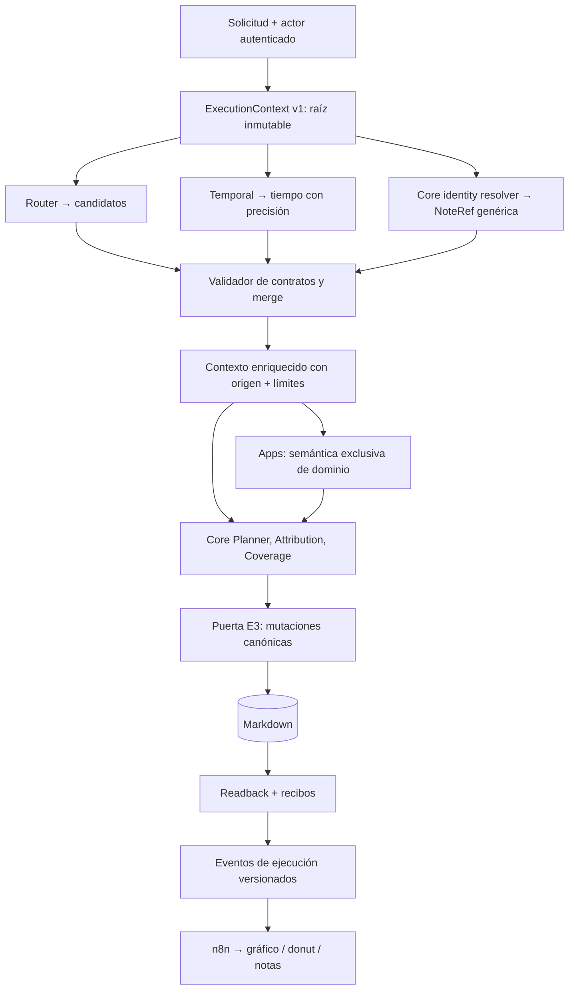

# E2 — Contrato compartido de contexto, capacidades y evidencias

**Decisión funcional aprobada por el usuario: 14-10-2026.** Este es el contrato objetivo de E2 para un sistema componible de piezas («Lego»), NO la declaración de que todas sus integraciones están desplegadas. Ver estado efectivo en [Functional Roadmap](functional-roadmap.md). Base de rama E1: PR #153 DRAFT (aún no fusionada); E2 es una rama dependiente, nunca un reemplazo de E1 ni autorización de merge/deploy.

## Objetivo

Eliminar la amplificación de cambios entre Router, Temporal, Core, Apps y el gráfico de ejecución. Cada pieza declara sus entradas, salidas, efectos, fuente y autoridad; la composición detecta dependencias ausentes **antes** de ejecutar. El contexto conserva sin pérdida el texto original, fragmentos/offsets/hashes, actor autenticado, evidencias, identidades canónicas **genéricas de cualquier tipo de nota**, dependencias, incertidumbres y recibos/telemetría. Se reutilizan los tipos ya existentes (`CoreCandidateContext`, `DomainInterpretation`, `TemporalInterpretation`, `AuthenticatedActorContext`, `CoreSpeakerEvidence`, `ApplicationResult`, `OperationalEvidence`) en vez de construir un sistema paralelo de decisiones.

## Decisiones vinculantes

1. **Identidades y referencias genéricas.** `stable_note_id` identifica cualquier nota de `config/note-schema.json` (`person`, `task`, `work_session`, `project`, `calendar_day`, tipos futuros); `note_type` solo orienta reglas diferenciales. `SELF` es una *forma particular de resolver al hablante autenticado*, no el identificador de todas las acciones ni un requisito para relacionar María con Marta. La autoría de un envío nunca implica que el remitente sea el sujeto gramatical.
2. **Un contexto tipado, inmutable y versionado en la ejecución.** El runtime es dueño del ID, fuente y actor autenticado; Router propone candidatos; Temporal propone/resuelve anclas temporales; Apps añaden exclusivamente evidencias de su dominio; Core es dueño de identidades, autorizaciones y mutaciones. Las piezas obtienen una *vista mínima* según puertos declarados. Un dato transportado no gana autoridad por haber sido transportado ni porque lleve `verified` en JSON. Los pasos del modelo no reciben credenciales ni datos irrelevantes del vault.
3. **Contratos explícitos por capacidad.** `Protocol`/`dataclass`/registro de puertos compatible por `requires`/`provides`, con validación de esquema/versión, preflight antes de efectos, y adaptadores a los carriers probados. Evitar superclases con cientos de métodos o un orquestador de microservicios adicional. En la medida posible, reemplazar las conversiones duplicadas en vez de perpetuarlas. Las etapas independientes pueden prepararse en paralelo; efectos, dependencias semánticas y writes se ordenan adecuadamente.
4. **Temporal sin pérdida semántica.** Resolver *«hoy»* a fecha, pero preservar por separado calificadores *«esta tarde», «mañana por la tarde», «ayer por la noche»* con ancla de calendario + franja textual exacta; **no** asignar 15:00 u otra hora arbitraria. Los roles temporales los propone/valida el intérprete, nunca un diccionario rígido de frases; fuente original, zona y precisión permanecen verificables. Consumidores Tasks, Events, Calendar, Notes y Work Sessions acceden a la misma representación sin reparseo autónomo.
5. **Interfaz y gráfico como consumidores genéricos.** Cada etapa emite eventos observados con `request_id`, `stage_id`, padre, orden, estado, duración/coste disponibles y resumen acotado sin trazas privadas; runtime → n8n → web deben validar la misma versión. La UI proyecta etapas reales; el donut no inventa progreso ni pierde entradas cuando se agrega una capacidad; estados parciales y recibos sobreviven al transporte. El contrato de telemetría jamás confiere autoridad de escritura.
6. **Un único camino final de mutación es E3.** Chat puede pasar por Router/Temporal/Planner; checkbox/edición por UI pueden omitir interpretación; un editor de Work Session/Fact puede invocar optativamente el servicio *común* de resolución de notas y links. Todas confluyen en E3, que centraliza autorización, targets, revisiones/concurrencia, referencias, idempotencia, materialización/historial y readback, reutilizando `materialization.py`/`persistence.py`/Writer existentes, no otro Writer. Work Sessions son Notes con lifecycle diferencial y texto capaz de enlazar con cualquier otro tipo de nota. **No** desarrollar ahora todos los botones ni rediseñar la UI.
7. **Seguridad.** Core valida siempre el texto/offsets/hashes, vinculación de actor y autoridad específica del emisor, frescura, completitud y destino antes de la mutación. Atributos externos autoafirmados, similitudes de nombres o sugerencias de Router no son garantías. Conservar fail-closed y aislamiento local-first. No tocar PROD ni vault real para pruebas.

## Arquitectura de puertos



La flecha Core Identity se refiere a un *servicio compartido*, no a un tercer modelo obligatorio. La preparación puede ser concurrente solo cuando no existe relación de datos entre etapas. Los gráficos describen el destino, no aseguran que todos los adaptadores ya estén desplegados.

## Ejemplos contractuales

- «Ayer María vio a Marta»: actor autenticado distinto de sujeto; dos referencias `NoteRef` tipo `person`, **ningún** `SELF`.
- «Hablé con Eric»: `SPEAKER` propuesto por fuente; el validador Core decide si puede usar `SELF` como referencia a una Note person existente.
- «Hoy preparé el informe para Proyecto Atlas»: relaciones genéricas a `project` y posibles `task`, sin validadores nuevos por cada NoteSchema.
- «Mañana por la tarde»: `{source:"mañana por la tarde", date:"2026-10-15", daypart:"por la tarde", exact_time:null, timezone:"Europe/Paris"}` con fecha de referencia 14-10-2026.
- UI Work Session: editor → (resolución opcional de entidades) → E3; no necesitar Router/Planner para una edición de estructura ya identificada.

## Definición de terminado de E2

- Un port y un contexto compartido funcionan en un flujo productivo con adapters para Router, Temporal, Core y Apps, sin autoridad implícita ni caminos de contexto competidores.
- Generic NoteRef y ambigüedad probados con al menos person, task, project, work_session y calendario más un tipo desconocido definido en esquema; no existe `person_id` como infraestructura general.
- Qualifiers temporales conservan precisión original en handoff de Temporal al consumidor y (cuando el producto pide texto) a la salida Markdown/UI; tests de día sin cualificador, fecha con franja, exact time y ambigüedades.
- Una App ficticia consume el contrato sin cambiar el dispatcher central ni crear su propia lógica de fechas/enlaces/escritura.
- Pruebas negativas: actor falso, offsets/hashes alterados, evidencia sin resolver, contexto cruzado, proveedor adversarial, entregas parcialmente escritas y replay.
- Un evento nuevo de backend sobrevive al contrato runtime→n8n→web sin cambiar listas rígidas en cada capa; respeta costes/latencias y no revela contenido sensible.
- Tests unitarios + verticales y gate del despliegue independiente; nunca confundir pruebas sintéticas con aceptación de modelo real. Sin nuevos servicios, graph DB ni reescritura general.

## Architecture challenge (inicio E2)

**PROCEED**, con alcance incremental: `DomainInterpretation`, `CoreCandidateContext`, contratos de actor y telemetría ya resuelven partes importantes. Un contrato común de *transporte y comprobación* encima de esos modelos es más sencillo que reescribir Core o sustituir todo por un framework/ABC común. Riesgo prioritario: que un `Context` universal duplique fuentes de verdad o filtre privilegios a Router. Mitigación: estructura inmutable limitada, validación estricta, proyección de mínimos por etapa, persistencia/identidad solo mediante Core; primer slice provider-free en rama dependiente E1. No se requieren cambios de proveedor, despliegue, esquema canónico ni servicios.

## Primer incremento implementado (15-10-2026, provider-free, NO desplegado)

- `odyssey_core/execution_context.py`: `ExecutionContext(version=1)` inmutable, fuente/fecha/actor autenticado inmutables; reutilización validada de `CoreCandidateContext` y `DomainInterpretation`, sin duplicar sus semánticas. `NoteReferenceCandidate`/`NoteMention` representan **hipótesis** genéricas de cualquier `NoteSchema`, no resuelven identidades ni autorizan mutaciones. `QualitativeTime` conserva un cualificador literal verificado contra un `temporal_reference` exacto existente; no añade 15:00 ni analiza lenguaje con diccionarios.
- Puertos explícitos `ContextPort`/`StageSpec`/`StageInput`/`StageOutput`/`ContextStage(Protocol)` y `run_context_stage` validan datos disponibles, origen y outputs declarados. `stage_input` oculta actor, reloj y evidencias fuera de los puertos solicitados. `run_independent_stages` usa threads solamente para propuestas sin dependencia entre outputs; valida dependencia *antes* de ejecutar y fusiona el resultado a una nueva copia inmutable. No paraleliza escrituras.
- `odyssey_runtime/candidate_route_dispatch.py`: justo antes del Planner/Writer de Core, valida un `ExecutionContext` formado por el `CoreCandidateContext` revisado, las evidencias `DomainInterpretation` y el actor confiable; entrega a Core el carrier revalidado, sin sustituir sus guards ni cambiar las acciones propuestas. Es una primera conexión real del nuevo contrato, **todavía no una migración completa de todos los traspasos**, y no ejecuta `StageSpec` del Router/Temporal de producción en este slice.
- `tests/core/test_execution_context.py`: contrato simulado completo Temporal + resolvedor genérico de tipos de nota + App ficticia, equivalencia de orden de dos contribuciones, ejecución realmente simultánea mediante barrier, dependencia negativa, inmutabilidad, fuente falsa, actor falsificado, capacidad duplicada, fechas/cualificadores incongruentes, referencia ambigua y `no-write` implícito. Los tests de dispatcher real, Tasks, Writer y Temporal cubren el seam sin cambios semánticos.

**Gate primer incremento:** full pytest **3184 passed, 80 skipped, los mismos 10 fallos históricos preexistentes** (52 subtests), Node **150 passed**, Ruff lint/format, esquema canónico y diff correctos. Estos tests no prueban que el LLM genere dayparts ni que la UI los renderice.

**No está hecho:** producción de `QualitativeTime` por el modelo real; links automáticos de editor/UI, serialización uniforme de eventos Python→n8n→web, todas las Apps como consumidores nativos del contexto, repositorio de identidad canónica, pruebas live/deploy y E3. Estas entregas siguen en los gates de arriba; ningún port por sí solo vuelve infalible la interpretación gramatical.

## Segundo incremento — búsquedas independientes y precisión temporal (15-10-2026, provider-free)

**Objetivo comprobado:** las menciones independientes a María, Marta, un proyecto, documento o cualquier tipo *referenceable* pueden consultarse en paralelo entre sí y con Temporal, sin sacrificar la fuente, fabricar identidades o escribir en el Vault. No hay obligación de insertar búsquedas adicionales de modelos tras cada frase: el despachador de las búsquedas trabaja con menciones **ya extraídas** y offsets originales. La extracción de menciones, selección semántica/contextual, anáforas y sujetos colectivos siguen sujetos a Core y las evidencias source-bound.

- `odyssey_core/note_lookup_batch.py`: nuevo **adaptador fino** `ParallelExactNoteLookup`, que delega cada mención en `resolve_exact_entity` existente de Core, sin rehacer normalización de nombres, alias o lectura canónica. `NoteLookupRequest(text,start,end,note_type?)` conserva los offsets; máximo **12 menciones / 3 workers** por lote, preserva orden lógico aunque las búsquedas acaben desordenadas, prohíbe spans duplicados/forjados, devuelve `NoteMention` con candidatos tipados y `PendingContext` anclado a la mención para ausencias, ambigüedad y tipos no compatibles; más de 8 homónimos queda pendiente íntegramente, NUNCA truncar arbitrariamente. Error de un worker falla todo el lote antes de merge, sin partial knowledge ni mutaciones; cada request Core revalida en escritura la identidad y estado del repositorio.
- **Corrección del inventario tras comprobar el esquema COMPLETO del runtime:** el fichero base `config/note-schema.json` declara `{concept, project, document, person, journal_entry}` como referencia ordinaria. Pero `odyssey_runtime/composition.py` compone también `TASK_SCHEMA_EXTENSION` y **`task` SÍ está declarado como `referenceable=True` en el esquema de producción**, de modo que el mismo `resolve_exact_entity` Core lo resuelve. `work_session` se declara `referenceable=False`, `notes_visible=False`, `content_writable=False` y tiene lifecycle propio de Tasks; `calendar_day` se gestiona por fecha determinista en Core y tampoco es una referencia ordinaria. No tratar estas últimas entidades como `person` ni convertir permisos de lectura en facultades de link/mutación. En fixture con esquema compuesto, el lote concurrente real resuelve Marta, Task y Proyecto Atlas con una única implementación genérica.
- `odyssey_core/execution_context.py`: `NoteMention` y `PendingContext` llevan offsets exactos opcionales y permanecen validados al fusionar en el contexto; una fecha exacta común satisface el puerto `TEMPORAL` aunque no tenga franja («hoy» no puede romperse al introducir «por la tarde»). Los puertos son proyecciones de datos, nunca permisos de lectura general/Writer.
- `odyssey_core/temporal_qualifier_handoff.py` + `odyssey_runtime/candidate_route_dispatch.py`: cuando **la misma** mención de `TemporalInterpretation` tiene resolución `EXACT_DATE` y una única cita `time_approx` de `CoreCandidateContext` se encuentra dentro de su span original, el runtime conserva también `QualitativeTime(date, qualifier, timezone)`, solo si coincide con un `DomainInterpretation` temporal exacto. No se inventan horas; nada que no esté doblemente anclado se eleva a evidencia. Se usa la zona horaria del Temporal si existe, si no la configuración. La estructura está enlazada al handoff hacia Core, pero **no se ha completado** el consumo de esas franjas por Planner, Writer, Markdown o UI. «Esta tarde» sin resolución de fecha exacta y casos `UNSPECIFIED` siguen requiriendo el trabajo E2 del intérprete, sin aceptar inferencias arbitrarias.
- `tests/core/test_parallel_note_lookup.py`, `test_temporal_qualifier_handoff.py`, `test_execution_context.py`: semántica real de `resolve_exact_entity` con dos Martas homónimas y dos menciones, María y proyecto; búsqueda exacta sin coincidencias, tipo gestionado, búsqueda en paralelo con barrera, simultaneidad entre batch y Temporal, overflows, errores parciales, fakes de fuente, plus temporal multilingüe ES/FR/EN, exact time incompatible y fecha sin cualificador. Las pruebas funcionales de `candidate_route_dispatch`/Writer guardan las rutas existentes.

**Rendimiento:** la paralelización propuesta es acotada porque cada `resolve_exact_entity` ordinario lee notas; en vaults grandes un fan-out aumenta lecturas simultáneas. Comparar latencia, CPU, E/S y memoria en fixtures representativos antes de habilitarla para todas las solicitudes DEV. Un snapshot compartido/batch indexable puede resultar más eficiente después, pero no se debe duplicar un resolvedor canónico ni relajar sus validaciones para obtener velocidad. El lote actual no participa todavía en los caminos automáticos del chat: es un adaptador verificable llamado por el sistema de puertos y listo para registrar menciones extraídas cuando esa frontera se estabilice.

**Gate verificado del segundo incremento:** suite completa Python **3202 passed, 80 skipped, los mismos 10 fallos históricos existentes** (52 subtests), Node **150 passed**, Ruff check/format, schema y diff PASS. El aumento de tests corresponde a los contratos genéricos, batch real de Core y los time qualifiers. PR apilada #154 continúa DRAFT; E2 sigue abierta.

## Tercer incremento — unificación de puertos de tipos gestionados (15-10-2026, DRAFT)

- `odyssey_core/managed_note_identity.py` introduce un **`ManagedNoteIdentityPort(Protocol)`** de solo lectura, implementado por composición y **sin herencia** en `CalendarDayIdentityPort` (delegación en `CalendarDayRepository.resolve`) y `WorkSessionIdentityPort` (delegación en `TaskWorkSessionService.list_for_task` bajo propietario Task explícito). Un `ManagedNoteHandle(stable_note_id, note_type, owner, materialized)` es **evidencia de localización, no un `NoteReferenceCandidate` autorizable**. `locate_managed_note` valida el propietario real declarado por el esquema compuesto y el tipo de resultado. La búsqueda de Work Session exige ID exacto y Task padre; no convierte menciones ambiguas a sesión en enlaces. Un Calendar Day virtual no se materializa por consultarlo.
- `ManagedNoteContextStage` implementa el mismo `ContextStage(Protocol)` y utiliza `StageSpec` para adjuntar esos handles al `ExecutionContext` bajo el puerto `MANAGED_NOTES` de forma inmutable. Cualquier App puede consumirlos mediante `stage_input`, sin permitir acceso al actor ni a la fuente si no los declara. Sigue siendo un adaptador de lectura y NO sustituye el Writer ni la autorización de mutación de E3.
- `tests/core/test_managed_note_identity.py` demuestra el contrato sobre fixtures de Notes reales: Task se identifica con el **Core exacto existente y esquema extendido**, días virtuales/materializados mediante el dueño Core, Work Sessions existentes y restringidas por Task propietario, propietario falso/método mal tipado rechazado en el resultado de ejecución y dos tipos de nota gestionados agregados al contexto común. Un ejemplo de texto de actividad de Work Session con «Proyecto Atlas» pasa por `ParallelExactNoteLookup` y prepara la referencia genérica `project` sin escribir enlaces todavía.
- **Cómo se impone `Protocol`:** Python acepta *structural typing* sin heredar de la clase `Protocol`; el tipador estático debe verificar firmas y retornos, mientras que `@runtime_checkable`/`isinstance` **solo inspeccionan presencia de atributos**, no tipos de parámetros o resultados. Por eso E2 valida explícitamente `StageSpec`, `StageInput`, `StageOutput`, propietario, esquema y `ManagedNoteHandle` después de la llamada. En el entorno Pi actual no hay mypy/pyright instalado; la prueba de forma en tiempo de ejecución NO sustituye una comprobación estática futura. Los ejemplos explicativos de esta diferencia pertenecen a la documentación del contrato.

**Gate completo tras el tercer incremento:** **3214 Python passed, 80 skipped, los mismos 10 fallos históricos** (52 subtests), **150 Node passed**, Ruff lint/format, validación de esquema y diff PASS. Los fallos históricos de benchmarks/prompt configs y pricing aún hacen que el comando global de pytest termine con exit 1: sin regressiones nuevas, pero no se debe etiquetar el gate global como verde. No se han ejecutado pruebas con proveedor ni despliegue del código de E2.

**Pendiente:** producción automática de `NoteLookupRequest` con offsets desde la fuente, adaptadores completos del editor Work Session y UI, conversión verificada de referencias en Markdown mediante el gate E3, cobertura de concurrencia/latencia en grandes vaults y eventos versionados hasta el gráfico. No se ha cambiado el `TASK_SCHEMA_EXTENSION` ni la autoridad de Work Sessions.

## Cuarto incremento — fuente → lookup → Planner compatible; un solo recorrido del Vault (15-10-2026)

**Problema detectado mediante medición en la Raspberry Pi:** la prueba descartable con 260 Note `person` válidas y 3 menciones independientes arrojó **~113 ms** secuencial frente a **~147 ms** con tres lectores concurrentes: cada llamada a `resolve_exact_entity` volvía a leer y validar las mismas 260 notas. El fan-out por hilo no puede asumirse más rápido que un trabajo I/O repetido.

**Corrección general, sin tercer resolvedor:** `odyssey_core/identity.py` ofrece `find_exact_entity_candidates_batch` y `resolve_exact_entities_batch`: **exactamente la lógica de identidad existente** (Unicode NFC, casefold, espacios, nombre vs alias, tipo del NoteSchema, deleted, homónimos y orden) ahora recorriendo cada nota **una sola vez** para las 1–12 consultas; el método anterior `find_exact_entity_candidates` delega a ese mismo batch con una sola consulta. Un error de nota canónica invalida el lote completo, no entrega éxitos parciales. El adaptador `ParallelExactNoteLookup` utiliza este batch como camino real predeterminado (puede ejecutar una búsqueda única en paralelo con Temporal); la estrategia por hilos queda para implementaciones inyectadas con trabajos que sí sean independientes. La medición con el mismo fixture cayó a **~38 ms** por lote, ~3× más rápido que tres resoluciones secuenciales. Es una medición local sintética, no una promesa de latencia DEV o producción. No se ha modificado el esquema canónico ni las reglas de autorización.

**Fuente común de menciones (evita parches por frases):** `canonical_source_context.source_note_role_spans` y `note_lookup_batch.note_lookup_requests_from_source_roles` comparten las roles genéricas **subject / participants / object / reference** validadas por `CoreCandidateContext`. Su extracción lleva posición Python exacta, conserva usos repetidos de una misma nota, deduplica el mismo span citado dos veces y no adivina nombres, separa por `y`, ni supone que todo es `person`. El helper antiguo `matching_canonical_source_names` vuelve a usar esa misma extracción, conservando sus comprobaciones de hints sin otorgar autoridad al Router. Más de 12 spans requiere tratamiento explícito: no se truncan ni se inventan identidades.

**Primera ruta real compatible, sin modificar la existente:** `odyssey_runtime/context_planner_ports.py` introduce `ContextAwareCorePlannerFactory(Protocol)` con método `create_for_context(ctx: ExecutionContext)`. En el dispatcher híbrido, cuando el factory implementa *estructuralmente* este puerto, se ejecuta la preparación tipada E2 desde los roles actuales: `ExecutionContext` → `NoteLookupRequest` → `ParallelExactNoteLookup` → `ExecutionContext.note_mentions/pending` → `create_for_context(ctx)` → **Planner de Core original** → Core coverage/preflight → Writer/readback originales. Los factories existentes con forma `factory(candidate_context, domain)` siguen ejecutándose **sin lecturas añadidas, mismo contrato, mismo Writer**. Esta puerta es de lectura: los NoteReferenceCandidates son hipótesis, no identidad validada para escribir. No se altera el prompt ni el modelo de producción.

```python
@runtime_checkable
class ContextAwareCorePlannerFactory(Protocol):
    def create_for_context(self, context: ExecutionContext) -> object: ...

# Compatible SIN heredar el Protocol:
class MiPlannerFactory:
    def create_for_context(self, ctx):
        # ctx.note_mentions = candidatos fuente+offsets, sin autoridad de write
        return planner_core_existente

# Dispatcher: crea contexto, ejecuta etapa de lookup, y usa el nuevo puerto
# solo si el factory está conectado. La rama antigua continúa intacta.
```

**Evidencia de integración:** `tests/runtime/test_e2_context_planner_integration.py` ejecuta un route v2 real `«Hoy hablé con Bea.»` con fuente exacta, rol participants, Temporal, Core candidato/cobertura, **Core Writer y Markdown readback**, comparando el puerto nuevo y el factory de dos argumentos antiguo. Los tests de `identity.py` cubren alias, Unicode, homónimos intertipo, ausencia, una sola enumeración de vault y fallo de un Note inválido; los tests del adaptador prueban reaparición de Marta en dos offsets de la misma frase y protección de presupuesto. No hay escrituras fuera de fixtures.

**Gate de regresión tras el cuarto incremento:** pytest completo **3222 correctos, 80 omitidos, los mismos 10 fallos históricos** (52 subtests), por tanto comando global exit 1, no «todo verde». **150 Node correctos**, Ruff lint/format, esquema y diff PASS; **46 pruebas específicas** de contexto fuente, batch, identidad, alias y Writer, más el resto de la suite. No se ejecutaron proveedores ni deploy ni mutación del vault personal.

**Limitación explícita:** en producción, el constructor real del Planner aún utiliza el factory antiguo y el `matching_canonical_source_names` de lectura única; el nuevo contrato se activa solo con una implementación `ContextAwareCorePlannerFactory` inyectada. Temporal sigue procesándose antes del lookup en el dispatcher actual; su paralelización con la lectura en una ejecución real requiere reubicar la preparación en el motor que ya conoce los grupos, preservando dependencias y la decisión de no duplicar lecturas. E2 no está cerrada ni desplegada.

## Quinto incremento — composición híbrida real + ejecución simultánea + hint único (15-10-2026)

- **Conexión a la composición efectiva:** `odyssey_runtime/composition.py` ahora crea `OpenAILunaContextPlannerFactory` para el **hybrid DEV opt-in** en lugar de la antigua lambda `(candidate_context, domain)`. El adaptador implementa estructuralmente `ContextAwareCorePlannerFactory(Protocol)` y crea el **mismo** `OpenAILunaExperimentalPlanner` con mismo cliente, esquema compuesto, reloj, modelo GPT-5.6, esfuerzo y prompts predeterminados. Los Planners antiguos de dos argumentos siguen siendo compatibles en el dispatcher (ninguna migración global, sin cambio de proveedor ni nueva autoridad de escritura). **No significa que se haya activado hybrid ni desplegado E2 en DEV.**
- **Paralelismo real y seguro:** dentro de **cada ruta scoped ya validada** (después de comprobación de procedencia e herencias temporales, no sobre rutas futuras), `candidate_route_dispatch.run_unit` lanza **una** búsqueda Core exacta en un worker y ejecuta la llamada de Temporal en el hilo del dispatcher. `ThreadPoolExecutor` se cierra antes de continuar al Planner y el resultado se fusiona en un solo `ExecutionContext` fuente/actor/temporal/note_mentions/pending; error de cualquier paso impide llegar al Writer. No se hacen escrituras concurrentes, no se comparte el cliente del proveedor con el worker y no se prefetchean rutas que dependan de un hecho anterior pendiente de escribir.
- **Un solo recorrido del vault también para el contexto de Luna:** la API canónica `resolve_exact_entities_batch` rellena metadatos de extracto de contenido de Notes validadas (campo `content_excerpt` privado de `ExactEntityCandidate`, excluido de comparaciones de identidad y repr). `ParallelExactNoteLookup` genera dentro del mismo scan los `CanonicalSourceNameHint` de nombres primarios únicos, sin promover alias ni homónimos ambiguos, y los transporta por `ExecutionContext.source_note_hints`/puerto `SOURCE_NOTE_HINTS`. El Planner nuevo consume estos hints existentes en vez de ejecutar el `matching_canonical_source_names` histórico que escaneaba el Vault **de nuevo**. El factory antiguo sigue utilizando el mecanismo original. Una nota no referenciable o con homónimo aún requiere atención al compararla con el contexto de otros tipos: los tests solo prueban paridad con los casos reales provistos; el contrato del modelo congelado y el gate live siguen abiertos.
- **Presupuesto de lectura:** si las propuestas de Router incluyen más de `MAX_MENTION_LOOKUPS=12` spans únicos, se registra `PendingContext(LOOKUP_BUDGET_EXCEEDED)` de búsqueda opcional y se utiliza el antiguo mecanismo acotado de hints, sin tratar las primeras 12 menciones como una selección privilegiada, sin bloquear un plan que Core podría ejecutar por otra vía y sin relajar la validación del Writer. Falsas referencias/offsets siguen rechazadas; una nota Markdown inválida encontrada por el resolvedor sigue siendo error cerrado.
- **Pruebas:** `test_e2_composed_parallel_contract.py` verifica que `OpenAILunaContextPlannerFactory` satisface el Protocol **sin herencia** y conserva configuración de constructor Luna, paridad exacta de los hints (incluido fragmento de contenido) con el scanner histórico en corpus congelado F07 y ante un homónimo añadido, simultaneidad **real** de Temporal y lectura del Vault mediante `Barrier(2)` en hilos distintos, y continuación del Writer bajo límite de menciones. `test_e2_context_planner_integration.py` mantiene el E2E sintético nuevo y legacy con lectura física de Markdown; otra prueba utiliza directamente la clase **real** `OpenAILunaExperimentalPlanner` con un `plan()` de fixture (sin llamar al proveedor), para demostrar que los hints reciben la misma información y el Writer real funciona. Suite global y chequeos registrados en `functional-roadmap.md`.

**Gate tras quinto incremento:** full pytest **3228 passed, 80 skipped, 10 fallos históricos preexistentes** (52 subtests), proceso pytest exit 1 por los diez antiguos casos, **0 regresiones nuevas**; Node **150 passed**, Ruff lint/format, schema, diff y tests de integración con la clase Luna real bajo provider stub PASS. Benchmarks anteriores sobre corpus de prueba, sin llamadas de pago. El prompt y la configuración de modelo no se han alterado a propósito, pero solo el gate de modelo real con la configuración vigente puede acreditar equivalencia semántica. No se autoriza deploy por este checkpoint.

**Límites restantes:** el constructor híbrido real está ahora conectado, pero no desplegado; el grafo y el donut no consumen eventos nuevos aún; `QualitativeTime` permanece contextual y todavía no se aplica a Markdown/Calendar/Tasks/Work Sessions; el gate live del modelo y el smoke DEV se realizan solo con aprobación de la etapa correspondiente y sin tocar PROD. La obligatoriedad/autoridad de los owner-managed Note links pertenece a E3.

## Continuidad

E2 se implementa en `feat/e2-shared-context-contract`, worktree `/home/ragdehl/projects/odyssey-e2-contract`, base `feat/e1-cross-boundary-integrity` PR #153, todavía DRAFT. **PR #154 DRAFT** es apilada explícitamente sobre #153; commit inicial `244f93f`. Ninguna está fusionada o desplegada. Estado exacto y test evidence en el roadmap de ESTA rama. Después E2 → E3, no volver a prolongar E1 mediante parches de frases. Merge y deploy requieren consentimiento explícito y gates.
